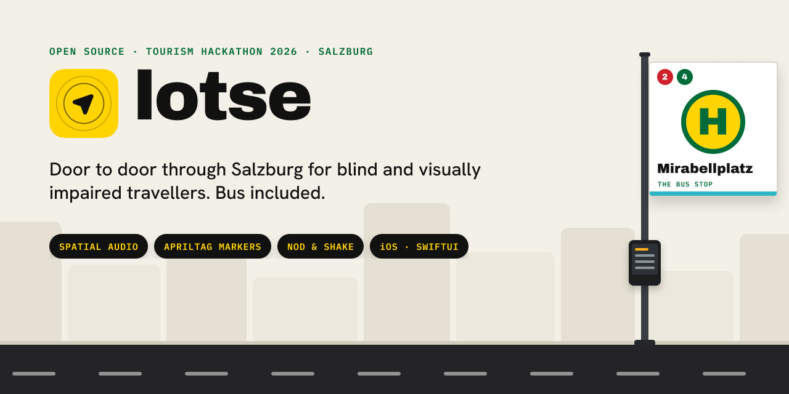

# Lotse



**Lotse** (German for a harbour pilot, the one who guides ships safely into port) is an iPhone app that
guides blind and visually impaired travellers door to door through Salzburg, bus ride included.

* **Spatial audio:** a beacon in the AirPods Pro plays from the direction to walk in.
* **Stop markers:** printed AprilTag markers at the stop tell the camera which side of the street and
  which bay the rider is at, and lead them to the waiting spot.
* **Head gestures:** nod to answer yes ("Board bus 2?"), shake for no. Voice and one large on-screen
  button work too.
* **Siri:** "Guide me with Lotse" starts a trip by voice.
* **Driver screen:** the bus driver gets a heads-up when someone is waiting and when they want to get off.

Built at the Tourism Hackathon 2026 in Salzburg. Product spec: [SPEC.md](SPEC.md). The Xcode project
and code still use the working name `NoValleyDuck`, so the target, scheme and folders keep that name.

## Marker pipeline (branch `feat/marker-detection`)

```
GPS ─► LocationGate ─► current stop ─► valid marker IDs
                                          │
camera ─► AprilTag (tag25h9) ─► MarkerTracker (safety filter) ─► GuidanceEngine ─► MarkerStateMachine
                                                                                        │
                                       MarkerPipeline: state, lock, events() ◄──────────┘
```

Marker IDs are reused between stops (tag25h9 only has 35 IDs). An ID means something only together
with the stop the rider is at, which comes from GPS (or the demo switch).

* **IDs:** 0–24 are bays and entrances, unique within a stop. 25–34 are bus-door markers, unique across the demo.
* **Safety filter:** a marker is only accepted when there are no corrected bits, margin ≥ 40, the ID belongs to this stop or is a bus door, and it was seen in 3 of the last 5 frames.
* **Soundscape/speech:** consume `MarkerPipeline` on the main actor. Observe `state` / `lock` or
  `for await e in pipeline.events()` (`found`, `arrived`, `lost`, `stopChanged`, `reducedRange`).
* **Timetable:** use `StopRepository.timetable(for:)` and then `departures(after:bay:limit:)`.

## Backend (PocketBase)

`https://novalleyduck.novafox.at`: collections `stops`, `bays`, `markers`, `facts`, `requests` and `timetables`.
Everything is publicly readable, so the app ships no credentials. The scripts use superuser
credentials from the environment. Never commit them.

```sh
export PB_EMAIL=… PB_PASSWORD=…
python3 tools/setup_pocketbase.py                       # schema + access rules (idempotent)
python3 -I tools/import_stops.py /path/to/gtfs_dir      # stops, bays, lines, 14-day timetables,
                                                        # OSM accessibility facts, demo markers
```

Re-run the import weekly, because timetables cover 14 days from the import date. It also rewrites
`NoValleyDuck/Data/DemoStop.json` and `DemoTimetable.json`, the offline fallback for the demo stop.

## Markers: print, assign, test

```sh
python3 tools/make_markers.py                    # PDF of every marker in PocketBase, labelled (A4)
python3 tools/make_markers.py 0 1 25 --paper a3  # specific IDs
python3 tools/assign_marker.py bays "Salzburg Mirabellplatz"           # bay labels/ids + directions
python3 tools/assign_marker.py bay "Salzburg Mirabellplatz" A 0 --size 0.145
python3 tools/assign_marker.py bay "Salzburg Messe" b09a9cc04f09183 0 --size 0.145   # unlabelled bay: by id
python3 tools/assign_marker.py door 120 25 --size 0.145                # bus door, line 120
python3 tools/assign_marker.py size 0 0.148 --stop "Salzburg Hauptbahnhof"   # after measuring
python3 tools/assign_marker.py list
```

1. Print at 100 % (not "fit to page") on matte paper.
2. **Measure the black square** and store it with `assign_marker.py size`. The distance can only
   be as accurate as that number.
3. Changes to the demo stop or the bus doors also update the bundled `DemoStop.json`, so rebuild the app afterwards.
4. Re-running the import never overwrites assigned markers or their sizes.
5. A marker only counts at the stop it is assigned to. At any other stop the debug view draws it
   red ("not here") and the app ignores it without a word: that is the safety filter, not a bug.

**Hall tests** (spec, run before building UI): in the debug view, switch on *Record hall test (CSV)*.
Each processed frame becomes CSV rows: `t_s, frame, stop, id, hamming, margin, side_px, status,
distance_m, bearing_deg, locked`. During recording the toggle shows how many locks happened.
For the false-positive test, that number must stay 0 with no demo markers in view. Get the files from
Finder (iPhone → Files → Lotse), from the Files app, or with the share button.

* **Range:** walk away in 1 m steps and see where `margin` drops and the rows stop.
* **Margin threshold:** pick `minMargin` above the margins of weak or false rows, and below the margins
  of real markers at the range you need. Then set it as the default in `MarkerPipeline.minMargin`.

## Driver screen

`driver/index.html` is a single static page for the bus driver (tablet or phone in the cab). The
driver picks a line and sees, live, every pickup request (`requests`) and stop request (`facts`,
`key = stop_requested`) on that line, with a chime. *Seen* sets the request's status to `seen`.
No login, no build step.

Deploy: copy the folder into PocketBase's public dir, then open `/driver/?line=1`:

```sh
scp -r driver <server>:<pocketbase dir>/pb_public/
# → https://novalleyduck.novafox.at/driver/?line=1
```

It also works opened straight from disk or any web server (it then talks to the default PocketBase;
override with `?pb=https://…`).

## Credits

* [AprilTag](https://github.com/AprilRobotics/apriltag), © The Regents of the University of Michigan,
  BSD 2-Clause (`NoValleyDuck/ThirdParty/apriltag/LICENSE.md`).
* Timetable and stop data: Mobilitätsverbünde Österreich OG,
  [data.mobilitaetsverbuende.at](https://data.mobilitaetsverbuende.at/), Salzburg Verkehr GTFS feed.
* Accessibility tags (tactile paving, wheelchair): © [OpenStreetMap](https://www.openstreetmap.org/copyright)
  contributors, ODbL 1.0.
